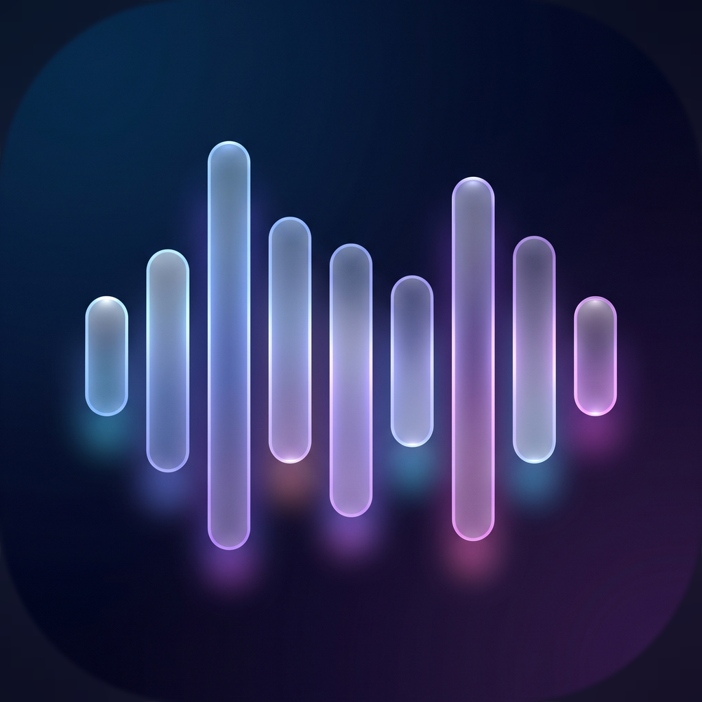

# AirWave · 局域网无损音频

把 Windows 正在播放的声音，通过同一个 WiFi 实时送到 iPhone。
**只传音频，不传屏幕**；锁屏、切后台继续播放，并且和其他 App 的声音混音共存。

<p align="center">
  
</p>

---

## 这一版解决了什么

豆包那一版能跑，但“连上后声音卡顿”的根因不止一个。AirWave 2.0 做了这些针对性修复：

| 问题 | 旧版 | AirWave 2.0 |
|---|---|---|
| 手机后台 1 秒断一次 | PC 端 3 秒收不到 HELLO 就踢掉客户端，iOS 后台定时器被合并时正好触发 | 客户端保留 15 秒；HELLO 间隔 0.75 秒；META 每 1.25 秒重发 |
| 周期性“咔哒/断音” | iOS 只预排 1 个 5 ms 缓冲，播完才排下一个，调度慢一点就 underrun | iOS 持续保持 3–8 个缓冲的提前量，2 ms 定时补充；欠载自动重预缓冲 |
| 网络抖动就静音 | 丢包直接补零，听感是硬断 | 丢包用上一包做淡出隐藏（PLC），并自适应加大缓冲 |
| 突发丢包 | 5 ms 小包，200 包/秒，WiFi 省电模式容易成串丢 | 默认 7 ms 包（143 包/秒），单包 ≤1400 字节，不触发 IP 分片；PC 发送线程与采集回调解耦 |
| 延迟越用越大 | 缓冲堆积没有上限 | 队列深度限制 + 超时丢旧包，延迟不会滚雪球 |
| 端口被旧版占用后“假连接” | 两个进程都能绑 13579，包被旧进程抢走 | 新默认端口 **13666**；启动前检查系统 UDP 表，冲突时明确报错 |

> 真正决定“稳不稳”的是接收端缓冲策略和心跳超时，而不是把包做得越小越好。AirWave 默认 7 ms 包 + 约 80–120 ms 自适应缓冲，并且把每个 UDP 包控制在 1400 字节以内——48 kHz 立体声如果发 10/20 ms 裸 PCM，一个包会超过 WiFi MTU，被 IP 分片后反而更容易丢。

---

## 目录

```
AirWave/
├── pc/                 Windows 推流端（Python + PySide6）
│   ├── app.py
│   ├── airwave/        UI、采集、UDP、协议
│   ├── assets/         app.ico / logo.png
│   ├── installer.iss   Inno Setup 安装脚本
│   └── dist/           构建产物（exe、安装包）
├── ios/                iPhone 接收端（SwiftUI + Network + AVAudioEngine）
│   ├── Sources/
│   ├── project.yml     XcodeGen 工程定义
│   └── .github/        GitHub Actions 未签名 IPA 构建
├── assets/             图标源文件与生成脚本
└── README.md
```

---

## 快速开始

### 1. Windows

1. 运行 `pc/dist/installer/AirWaveSetup-2.0.0.exe`。
2. 安装时保持勾选“添加 Windows 防火墙规则”。
3. 打开 AirWave，音频来源选 **系统声音**（默认就是当前扬声器回环）。
4. 点中间的大圆按钮“开始推流”，记下右上角显示的 IP。

> 默认抓取系统正在播放的声音。若某个 App 抓不到，安装 VB-Cable：把 Windows 输出设为 `CABLE Input`，在 AirWave 里选择 `CABLE Output`。

### 2. iPhone

1. 用 Sideloadly + 免费 Apple ID 安装 `AirWave-unsigned.ipa`（7 天需重签）。
2. 手机和电脑连同一个 WiFi。
3. 打开 AirWave，右上角设置里填电脑 IP，端口 `13666`。
4. 点中间圆钮连接；状态变成“正在播放”后，电脑放什么手机就响什么。

锁屏、切微信、开网易云都不会断；上滑杀掉 App 才会停（iOS 系统限制）。

---

## 使用技巧

- **弱网/隔墙**：iPhone 端延迟模式选“稳定”，PC 端保持默认 7 ms；单包大小已经按 MTU 优化，不需要也不应该再放大。
- **追求最低延迟**：PC 端切 `5 ms · 低延迟`，iPhone 端选“低延迟”，适合同一房间。
- **手机端**默认“自动”档，会根据抖动自己加缓冲；觉得延迟大可以手动切“低延迟”。
- 电脑换 WiFi、IP 变了，手机端重新填一次即可。
- 防火墙没放行时，PC 界面会用黄色提示；点“放行”并在 UAC 窗口确认。

---

## 常见问题

**连上了但没声音？**
1. 手机音量是否打开；
2. PC 是否真的在播放声音（AirWave 抓的是默认输出设备）；
3. 看 PC 日志里的“手机接入”和“已发送”是否在涨；
4. Windows 防火墙是否放行 UDP 13666。

**声音一顿一顿？**
- 先在 iPhone 设置里把延迟档切到“平衡”或“稳定”；
- PC 端保持 7 ms 包（5 ms 只适合同一房间）；
- 确认手机没有开“低电量模式”（会限制 WiFi 后台）；
- 路由器开启“节能/WMM”通常有帮助，2.4G 拥挤时优先 5G。

**提示端口被占用？**
旧版 `AudioStreamServer` 可能还在运行，或者你同时开了两个 AirWave。退出旧程序，或在 AirWave 里换一个端口（手机端同步修改）。

**锁屏就断？**
确认安装的是 AirWave 的 IPA，且 App 内已连接成功开始播放；iOS 需要 `UIBackgroundModes: audio`（已在工程里配置）。

---

## 从源码构建

### Windows

```powershell
cd pc
python -m pip install -r requirements-build.txt
python app.py                          # 开发运行
python -m PyInstaller AirWaveServer.spec
& "C:\Program Files\Inno Setup 7\ISCC.exe" installer.iss
```

产物：
- `pc/dist/AirWaveServer.exe`
- `pc/dist/installer/AirWaveSetup-2.0.0.exe`

诊断（不启动 GUI，输出设备列表）：

```powershell
.\dist\AirWaveServer.exe --diagnose-out diag.txt
```

### iPhone

没有 Mac 时，用 GitHub Actions 的 macOS runner 构建未签名 IPA：

1. 把 `ios/` 推到 GitHub；
2. Actions 里运行 **Build unsigned IPA**；
3. 下载 artifact，解压得到 `AirWave-unsigned.ipa`；
4. Sideloadly 侧载。

---

## 协议（给想改的人）

- 传输：UDP，PC 监听 `0.0.0.0:13666`。
- 手机 → PC：`HELLO`（0.75 秒一次）、`BYE`。
- PC → 手机：
  - `[0x01][len:u16 BE][JSON]` 元数据（采样率、声道、包帧数、stream_id）
  - `[0x02][seq:u32 BE][PCM s16le]` 音频包
- 元数据在每个 HELLO 和每 1.25 秒重发，丢一个包不会让手机变哑。
- 音频不加密、不做公网穿透，只适合可信局域网。

---

## 隐私

没有账号、没有云、没有统计上报。音频只在你的电脑和手机之间走局域网 UDP。
