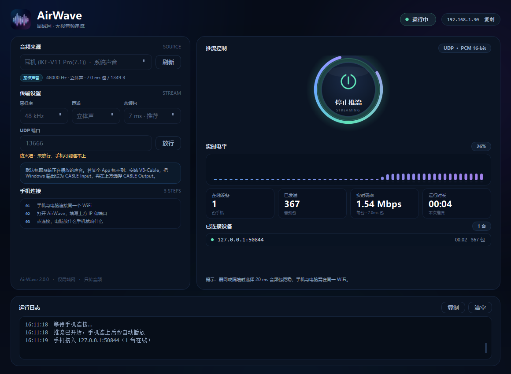

# AirWave · 局域网无损音频

把 Windows 正在播放的声音，通过同一个 WiFi 实时送到 iPhone。
**只传音频，不传屏幕**；锁屏、切后台继续播放，并且和其他 App 的声音混音共存。

<p align="center">
  
</p>

<p align="center">
  
</p>

<p align="center">
  
  &nbsp;&nbsp;
  
</p>

---

## 这一版解决了什么

豆包那一版能跑，但“连上后声音卡顿”的根因不止一个。AirWave 2.2 做了这些针对性修复：

| 问题 | 旧版 | AirWave 2.2 |
|---|---|---|
| 手机后台 1 秒断一次 | PC 端 3 秒收不到 HELLO 就踢掉客户端，iOS 后台定时器被合并时正好触发 | 客户端保留 15 秒；HELLO 间隔 0.75 秒；META 每 1.25 秒重发 |
| 周期性“咔哒/断音” | iOS 只预排 1 个 5 ms 缓冲，播完才排下一个，调度慢一点就 underrun | iOS 持续保持 2–18 个缓冲的提前量，4 ms 定时补充；欠载自动重预缓冲 |
| 网络抖动就静音 | 丢包直接补零，听感是硬断 | 丢包用上一包做淡出隐藏（PLC），并自适应加大缓冲 |
| 单个 UDP 包丢了就没救 | 无冗余，随机丢包直接变成断音 | 抗丢包双发：每包发两遍，手机按序号去重；PC 界面可随时关掉 |
| PC 忙时本地静默丢包 | 发送队列只有 6 个包，UI 一卡就丢到只剩 2 个，序号还连续，手机完全看不出来 | 队列加深到 24，积压超过 16 才丢；界面显示“本地丢弃 / 发送错误” |
| 突发丢包 | 5 ms 小包，200 包/秒，WiFi 省电模式容易成串丢 | 默认 7 ms 包（143 包/秒），单包 ≤1400 字节，不触发 IP 分片；PC 发送线程与采集回调解耦 |
| 延迟越用越大 | 缓冲堆积没有上限 | 队列深度限制 + 超时丢旧包，延迟不会滚雪球 |
| 端口被旧版占用后“假连接” | 两个进程都能绑 13579，包被旧进程抢走 | 新默认端口 **13666**；启动前检查系统 UDP 表，冲突时明确报错 |

### 版本记录

之前为了连续修复，安装包一直沿用 2.0.0、没有递增版本号；下面按实际交付内容补记，共 **7 个对外构建**。当前版本 **2.2.0 build 7**，版本号已经显示在 Windows 底部和 iPhone 设置页。

| 版本 | 内容 |
|---|---|
| 2.0.0 | 初版：PC 推流 + iPhone 接收、局域网、后台播放 |
| 2.0.1 | 音频卡顿修复：Int16 交错、`dataConsumed`、先预排再播放、去掉配置变化重建 |
| 2.0.2 | iPhone 设置页宽度修复 + 新浅色图标 |
| 2.0.3 | 设置里保存最多 8 个电脑 IP |
| 2.1.0 | PC 音浪律动组件、传输模式（高保真/低延迟/省流/96k）、96k 实际采样率提示 |
| 2.1.1 | 延迟漂移修复：按总排队量裁剪、自动档只对欠载加缓冲 |
| 2.2.0 | 当前：7ms 少包 + iPhone 极低延迟、5 档实时切换、版本号写入两端、Android 接收端；修复 2.1.1 的丢包回归 |

> 2.2.0 的丢包回归修复：把 iOS 音频 IO 从 5ms 恢复为稳定的 10ms；时钟校正不再计入网络丢包；5ms 自动关闭双发（400 → 200 包/秒）。实测最优组合是 **PC 7ms（143 包/秒）+ iPhone 极低延迟**：7ms 是 MTU 以内最大的包，包数最少，反而比 3ms/5ms 更稳，延迟也更低。

> 真正决定“稳不稳”的是接收端缓冲策略和心跳超时，而不是把包做得越小越好。AirWave 默认 7 ms 包 + 约 120–220 ms 自适应缓冲（含预排），并且把每个 UDP 包控制在 1400 字节以内——48 kHz 立体声如果发 10/20 ms 裸 PCM，一个包会超过 WiFi MTU，被 IP 分片后反而更容易丢。

---

## 目录

```
AirWave/
├── pc/                 Windows 推流端（Python + PySide6）
│   ├── app.py
│   ├── airwave/        UI、采集、UDP、协议
│   ├── assets/         app.ico / logo.png
│   ├── installer.iss   Inno Setup 安装脚本
│   └── dist/           构建产物（exe、安装包）
├── ios/                iPhone 接收端（SwiftUI + Network + AVAudioEngine）
│   ├── Sources/
│   └── project.yml     XcodeGen 工程定义
├── android/            Android 接收端（Kotlin + AudioTrack + 前台服务）
├── .github/workflows/  GitHub Actions 未签名 IPA / APK 构建
├── dist/               最终交付：Windows 安装包 + 未签名 IPA + APK
├── assets/             图标源文件、生成脚本、界面截图
└── README.md
```

---

## 快速开始

### 1. Windows

1. 运行 `dist/AirWaveSetup-2.2.0.exe`。安装包未做代码签名，若 SmartScreen 提示，点“更多信息 → 仍要运行”。
2. 安装时保持勾选“添加 Windows 防火墙规则”。
3. 打开 AirWave，音频来源选 **系统声音**（默认就是当前扬声器回环）。
4. “传输模式”选 **高保真 · 7ms**；追求最低延迟时保持 7ms，把 iPhone 切到“极低延迟”即可。弱网/隔墙可换 **省流**（单声道，带宽减半）。5ms 档包率更高，弱网反而更容易丢，不推荐。
5. 保持“抗丢包双发”勾选（默认开启）；带宽约 3 Mbps，弱网下比单发稳很多。
6. 点中间的大圆按钮“开始推流”，记下右上角显示的 IP。

> 默认抓取系统正在播放的声音。若某个 App 抓不到，安装 VB-Cable：把 Windows 输出设为 `CABLE Input`，在 AirWave 里选择 `CABLE Output`。

### 2. iPhone

1. 用 Sideloadly + 免费 Apple ID 安装 `dist/AirWave-2.2.0-unsigned.ipa`（7 天需重签）。
2. 手机和电脑连同一个 WiFi。
3. 打开 AirWave，右上角设置里填电脑 IP，端口 `13666`，点“保存此地址”。
4. 点中间圆钮连接；状态变成“正在播放”后，电脑放什么手机就响什么。

锁屏、切微信、开网易云都不会断；上滑杀掉 App 才会停（iOS 系统限制）。

### 3. Android

1. 安装 `dist/AirWave-2.2.0-android.apk`（debug 签名，首次需允许“安装未知应用”）。
2. 手机和电脑连同一个 WiFi，5 GHz 优先。
3. 打开 AirWave，点右上角“设置”，填电脑 IP 和端口 `13666`，可“保存此地址”；最多保存 8 个。
4. 点中间圆钮连接；第一次会请求通知权限（前台服务需要，拒绝也能播放，但通知栏不显示）。
5. 锁屏/切后台会由前台服务继续播放；通知栏可停止。

Android 端和 iPhone 使用同一个 PC 协议，支持 5 档延迟、保存 IP、丢包/欠载统计和 7ms 低延迟组合。

---

## 使用技巧

- **高音质 + 高稳定**：PC 端“高保真”（16-bit/48k 立体声），iPhone 端选“稳定”，总缓冲约 380ms。
- **低延迟**：PC 端保持“高保真 · 7ms”，iPhone 端选“低延迟”，总延迟约 85–100ms。
- **极低延迟（推荐组合）**：PC 端“高保真 · 7ms” + iPhone“极低延迟”，理想条件约 45–65ms；7ms 是 MTU 以内最大的包，143 包/秒（双发 286），比 5ms 的 200/400、3ms 的 333/666 少很多，WiFi 更稳。
- 5ms 档现在会自动关闭双发（200 包/秒），但仍然不如 7ms 少包稳。
- **省流/弱网**：PC 端“省流”（单声道，0.77 Mbps），带宽减半，iPhone 端选“低延迟”或“平衡”。
- **96k 高采样**：只有 Windows 声卡在共享模式下真的支持 96k 时才有效；如果 PC 详情里出现“已回退”，说明设备原生只有 48k，不是 iPhone 限制。iPhone 硬件通常也是 48k，96k 会被系统重采样。
- **手机端**默认“自动”档，会根据抖动自己加缓冲；觉得延迟大可以手动切“低延迟”。
- 延迟模式是**实时切换**的：切换时会丢弃旧的播放队列并按新目标重新预缓冲，通常有 0.1–0.3 秒的短暂停顿；2.1.1 及以前只改目标、不清旧队列，所以切到低延迟后要等旧缓冲播完才生效，还会造成假丢包。

### 实际延迟能压到 50ms 以内吗？

纯 WiFi + Windows 共享模式 + iPhone 外放，**稳定 50ms 以内不能保证**。链路大致是：

```text
Windows 采集 10–20ms + 7ms 包 + WiFi 3–10ms
+ iPhone jitter 21ms（3 个 7ms 包）+ 播放器提前量 14ms + 音频 IO 10ms
≈ 45–60ms，实际常见 45–65ms
```

- 想碰运气：PC “高保真 · 7ms” + iPhone “极低延迟”，5GHz、同一房间、PC 用网线接路由。7ms 的包数已经最少，不要再为了“低延迟”去切 5ms/3ms——那只会增加包率、增加丢包。抖动大就切回“低延迟/平衡”。
- 想**稳定**低于 50ms：让 iPhone 走有线——USB 网络共享或 Lightning/USB-C 以太网卡，和 PC 同一路由；网络抖动几乎没有，20–30ms 缓冲就能稳住。AirWave 不需要改代码，填有线网络的 IP 即可。
- GitHub 上没找到能直接搬的 iOS + Windows 低延迟接收端：SonoBus 是最接近的（PCM/Opus、低延迟），但作者也明确说 WiFi 抖动必须加大安全缓冲；AudioRelay 建议缓冲 30–50ms，10ms 不可持续；Snapcast 的同步缓冲更偏向 100ms 以上。
- 继续降 iOS 侧只能改成 `AVAudioSourceNode` 实时拉流（省掉播放器排队），但会重写已经调稳的音频路径，收益约 10ms，风险大于收益，暂不做默认。

- 设置里可以保存最多 8 个电脑 IP；下次打开设置，点一下“已保存的电脑”里的一行就会自动填入 IP 和端口，不用再手打。右侧垃圾桶可删除。
- 电脑换 WiFi、IP 变了，手机端重新填一次并保存即可。
- 防火墙没放行时，PC 界面会用黄色提示；点“放行”并在 UAC 窗口确认（规则只放行当前 UDP 端口，不区分网络类型，避免 WiFi 被 Windows 标成“公用网络”时连不上）。

---

## 常见问题

**连上了但没声音？**
1. 手机音量是否打开；
2. PC 是否真的在播放声音（AirWave 抓的是默认输出设备）；
3. 看 PC 日志里的“手机接入”和“已发送”是否在涨；
4. Windows 防火墙是否放行 UDP 13666。

**丢包率高 / 声音一顿一顿？**
1. 先看 PC 界面底部“本地丢弃 / 发送错误”：
   - 如果是 0，说明包已经发出去了，问题在 WiFi/手机侧；
   - 如果一直涨，把 PC 上的浏览器/游戏等占用 GPU 的程序关掉一些。
2. 保持 **7ms** 包和“抗丢包双发”开启；7ms 是 MTU 内最大的包，包数最少。不要为了低延迟切 5ms/3ms，包率翻倍反而更容易丢。
3. 手机延迟档切到“平衡”或“稳定”（稳定档总缓冲约 350–400 ms）；iPhone/Android 的“极低延迟”适合 5GHz 近距离。
4. 确认手机没开低电量模式；优先 5 GHz，离路由器近一点，避开微波炉/蓝牙拥塞。
5. 如果 PC 或 iPhone 开了 VPN，先关掉再试——VPN 的 MTU 更小，会额外切包。
6. 仍高的话，把 PC 的“本地丢弃/发送错误”和 iPhone 的“丢包/欠载”数字发我，再针对性调。

**选了 96 kHz，手机仍显示 48 kHz？**
不是手机写死 48k。Windows WASAPI **共享模式**下，采集格式必须等于声卡混音格式；大多数 Realtek / VB-Cable / 蓝牙耳机只有 48k，96k 打开会失败，PC 会自动回退到设备原生采样率，并在详情里显示“已回退”。iPhone 会跟随 PC 发来的 META；如果 PC 真发出 96k，手机端会显示 96k（硬件再按需重采样）。

**提示端口被占用？**
旧版 `AudioStreamServer` 可能还在运行，或者你同时开了两个 AirWave。退出旧程序，或在 AirWave 里换一个端口（手机端同步修改）。

**锁屏就断？**
iOS：确认装的是 AirWave 的 IPA，且已连接成功开始播放；需要 `UIBackgroundModes: audio`（已配置）。
Android：确认首次连接时允许了通知权限；AirWave 使用前台服务 + WiFi 高性能锁，锁屏应继续播放。部分国产系统需要在电池设置里把 AirWave 设为“不限制后台”。

---

## 从源码构建

### Windows

```powershell
cd pc
python -m pip install -r requirements-build.txt
python app.py                          # 开发运行
python -m PyInstaller AirWaveServer.spec
& "C:\Program Files\Inno Setup 7\ISCC.exe" installer.iss
```

构建产物在 `pc/dist/`：
- `pc/dist/AirWaveServer.exe`（绿色单文件版）
- `pc/dist/installer/AirWaveSetup-2.2.0.exe`（Windows 安装包）

最终交付目录 `dist/` 汇总了 Windows 安装包、未签名 IPA 和 Android APK。

诊断（不启动 GUI，输出设备列表）：

```powershell
.\pc\dist\AirWaveServer.exe --diagnose-out diag.txt
```

### Android

需要 JDK 17、Android SDK 34、Gradle 8.7；或在 GitHub Actions 运行 **Build Android APK**：

```bash
cd android
gradle assembleDebug
```

输出 `android/app/build/outputs/apk/debug/app-debug.apk`（debug 签名）。CI 产物会重命名为 `AirWave-2.2.0-android.apk`。

### iPhone

没有 Mac 时，用 GitHub Actions 的 macOS runner 构建未签名 IPA：

1. 把 `ios/` 推到 GitHub；
2. Actions 里运行 **Build unsigned IPA**；
3. 下载 artifact，解压得到 `AirWave-unsigned.ipa`；
4. Sideloadly 侧载。

---

## 协议（给想改的人）

- 传输：UDP，PC 监听 `0.0.0.0:13666`。
- 手机 → PC：`HELLO`（0.75 秒一次）、`BYE`。
- PC → 手机：
  - `[0x01][len:u16 BE][JSON]` 元数据（采样率、声道、包帧数、stream_id）
  - `[0x02][seq:u32 BE][PCM s16le]` 音频包
- 元数据在每个 HELLO 和每 1.25 秒重发，丢一个包不会让手机变哑。
- 音频不加密、不做公网穿透，只适合可信局域网。

---

## 隐私

没有账号、没有云、没有统计上报。音频只在你的电脑和手机之间走局域网 UDP。
